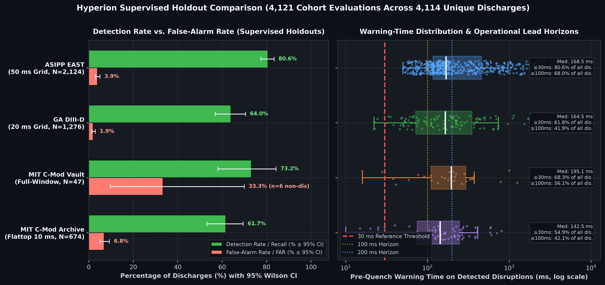
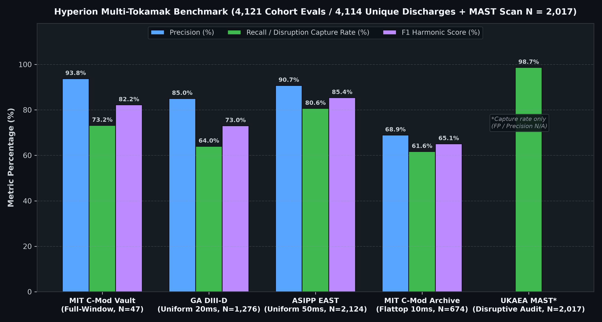
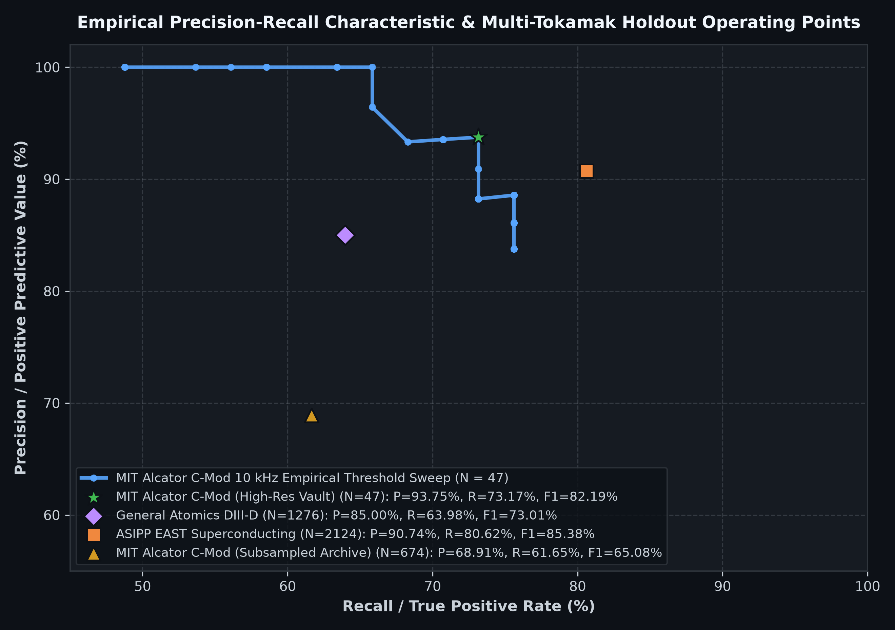
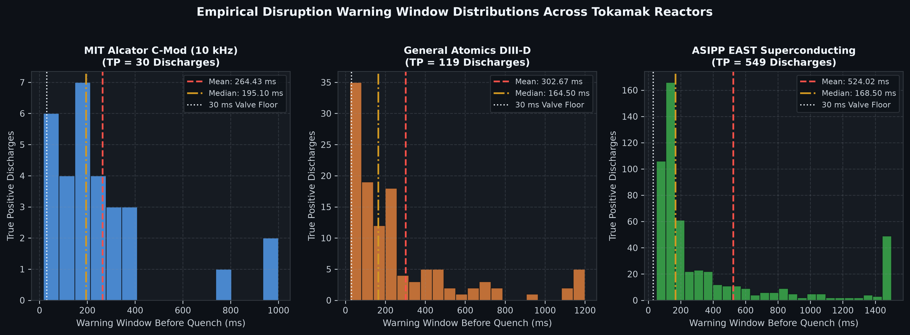

# Hyperion: Retrospective Disruption Warning Detection on Tokamak Archives

[](https://opensource.org/licenses/MIT)
[]()
[-informational.svg)]()

**Hyperion analyzes historical tokamak diagnostic records to test whether plasma disruptions can be flagged early enough for fast mitigation valves (`>= 30 ms` before quench) while tracking false alarms on non-disruptive runs.**

Sudden losses of plasma confinement in tokamak fusion experiments can damage vessel walls unless protective actuators trigger tens of milliseconds ahead of thermal quench, yet overly sensitive alarms interrupt normal plasma operations. Using only measurements available at each timestamp (future measurements excluded), we evaluated Hyperion offline across **four supervised holdout cohorts totaling `4,121` cohort evaluations (`4,114` unique `(tokamak, SHOT_ID)` discharges)** on **ASIPP EAST**, **General Atomics DIII-D**, and **MIT Alcator C-Mod**, plus a separate **`12,693`-discharge disruptive capture scan** on **UKAEA MAST**:

- **ASIPP EAST (`2,124` held-out discharges, `50 ms` grid):** Detected **`80.62%` of disruptions** (`549/681` recall) with a **`3.88%` false-alarm rate** on non-disruptive runs (`56/1,443`; `90.74%` precision) and a **`168.50 ms` `*(median)*`** (`524.02 ms` `*(mean)*`) warning lead time.
- **General Atomics DIII-D (`1,276` held-out discharges, `20 ms` grid):** Detected **`63.98%` of disruptions** (`119/186` recall) with a **`1.93%` false-alarm rate** (`21/1,090`; `85.00%` precision) and a **`164.50 ms` `*(median)*`** (`302.67 ms` `*(mean)*`) warning lead time.
- **MIT Alcator C-Mod (`2` separate cohorts, not a matched sampling-rate experiment):** Detected **`61.65%` of flattop disruptions** (`82/133` recall) with a **`6.84%` false-alarm rate** (`37/541`; `68.91%` precision; `142.50 ms` `*(median)*` warning) on the **`674`-discharge flattop archive**, and **`73.17%` of full-window disruptions** (`30/41` recall; `2/6 = 33.33%` false-alarm rate `[9.7%-70.0% CI]`; `93.75%` precision; `195.10 ms` `*(median)*` warning) on a separate **`47`-discharge `10 kHz` diagnostic vault** (`7` shared `SHOT_ID`s reconciled in [Section 1B](#1b-c-mod-cross-cohort-reconciliation)).
- **UKAEA MAST (`2,017` confirmed disruptions across `12,693` archived shots):** Detected **`98.66%`** (`1,990/2,017`) with **`151.18 ms` `*(mean)*`** warning lead time *(disruptive capture scan only; non-disruptive false alarms were not scored)*.

*Scope note:* All evaluations are retrospective offline replays on historical archives, not live closed-loop reactor control.

**[Detailed tables](#1-supervised-multi-tokamak-holdout-summary) · [C-Mod label reconciliation](#1b-c-mod-cross-cohort-reconciliation) · [Verify the evidence](#verify-the-evidence) · [Discuss an evaluation](#discuss-an-evaluation)**


*Opening summary (`4,121` supervised cohort evaluations across `4,114` unique held-out discharges): Left - Detection rate (recall `↑`) and false-alarm rate (`FAR ↓`) side by side with 95% Wilson confidence intervals. Right - Pre-quench warning-time distributions relative to the `30 ms` actuator timing reference.*

---

## 1. Supervised Multi-Tokamak Holdout Summary

*Evaluated Scope:* `4,121` supervised cohort evaluations across `4,114` unique `(tokamak, SHOT_ID)` discharges (`data/holdout/`), plus a separate `12,693`-discharge UKAEA MAST disruptive capture scan (`data/MAST/mast_cohort_summary.csv`). Full binary confusion matrices (`TP, FP, FN, TN`), 95% Wilson score confidence intervals, and warning-time distributions are stored in [`data/holdout/`](data/holdout/). For the separate UKAEA MAST 7-cohort archive scan ([`data/MAST/mast_cohort_summary.csv`](data/MAST/mast_cohort_summary.csv)), only confirmed disruptive discharges were audited (`2,017` disruptions across `12,693` scanned shots), so Precision, False-Alarm Rate (`FAR`), and F1 are not applicable (`N/A`). Direction indicators `(↑)` and `(↓)` show metric optimality; **bold** marks the strongest supervised cohort value in each column.

| Tokamak Cohort & Event Definition | Grid | Cohort Evaluations (`N`) | TP / FP / FN / TN | Detection Rate / Recall `[95% CI]` `(↑)` | False-Alarm Rate `[95% CI]` `(↓)` | Precision `[95% CI]` `(↑)` | F1-Score `(↑)` | Warning Lead Time* `(↑)` | Lead / `30 ms` Ref `(↑)` |
| :--- | :--- | :---: | :---: | :---: | :---: | :---: | :---: | :---: | :---: |
| **ASIPP EAST** *(flattop archive)* | `50 ms` | **2,124** | `549 / 56 / 132 / 1,387` | **80.62%** `[77.5-83.4%]` | `3.88%` `[3.0-5.0%]` | `90.74%` `[88.2-92.8%]` | **85.38%** | `168.50 ms` `*(median)*` | `5.62x` |
| **General Atomics DIII-D** *(flattop archive)* | `20 ms` | `1,276` | `119 / 21 / 67 / 1,069` | `63.98%` `[56.9-70.5%]` | **1.93%** `[1.3-2.9%]` | `85.00%` `[78.2-90.0%]` | `73.01%` | `164.50 ms` `*(median)*` | `5.48x` |
| **MIT Alcator C-Mod Vault** *(full-window HDF5)* | `1.0 ms`† | `47` | `30 / 2 / 11 / 4` | `73.17%` `[58.1-84.3%]` | `33.33%` `[9.7-70.0%]`‡ | **93.75%** `[79.9-98.3%]` | `82.19%` | **195.10 ms** `*(median)*` | **6.50x** |
| **MIT Alcator C-Mod Archive** *(flattop-only)* | `10 ms` | `674` | `82 / 37 / 51 / 504` | `61.65%` `[53.2-69.5%]` | `6.84%` `[5.0-9.3%]` | `68.91%` `[60.1-76.5%]` | `65.08%` | `142.50 ms` `*(median)*` | `4.75x` |
| **UKAEA MAST** *(disruptive capture scan)* | `Level-2` | `2,017` *(of 12,693)* | `1,990 / N/A / 27 / N/A` | `98.66%` `[98.1-99.1%]` | `N/A` | `N/A` | `N/A` | `151.18 ms` `*(mean)*` | `5.04x` |

*\*Warning times (`QUENCH_TIME_MS - ALARM_TIME_MS`) are computed across detected disruptions (`TP`): supervised holdout rows report `*(median)*` (with both `*(median)*` and `*(mean)*` in Table 1A below), while the UKAEA MAST 7-cohort summary reports cohort-weighted `*(mean)*`. †Raw `10 kHz` (`0.1 ms`) 352-channel C-Mod HDF5 diagnostics are evaluated on a standardized `2,000`-frame `[0, 2000] ms` window grid (`dt = 1.0005 ms`). ‡The 47-discharge C-Mod vault contains only `n = 6` non-disruptive runs (`FP = 2, TN = 4`), giving a wide `[9.7%-70.0%]` confidence interval on `FAR`.*

### Table 1A: Operational Lead-Time Horizons Across All Disruptions (`TP + FN`)

| Supervised Holdout Cohort | Total Disruptions (`TP + FN`) | Warned `>= 30 ms` (`All / TP ↑`) | Warned `>= 50 ms` (`All / TP ↑`) | Warned `>= 100 ms` (`All / TP ↑`) | Warned `>= 200 ms` (`All / TP ↑`) | Warning Lead Time: `*(median)*` / `*(mean)*` `(↑)` |
| :--- | :---: | :---: | :---: | :---: | :---: | :---: |
| **ASIPP EAST (`50 ms`, `N = 2,124`)** | `681` | **80.62%** (`100.0%`) | **80.62%** (`100.0%`) | **67.99%** (`84.3%`) | `33.92%` (`42.1%`) | `168.50 ms` `*(median)*` / **524.02 ms** `*(mean)*` |
| **GA DIII-D (`20 ms`, `N = 1,276`)** | `186` | `61.83%` (`96.6%`) | `57.53%` (`89.9%`) | `41.94%` (`65.5%`) | `28.49%` (`44.5%`) | `164.50 ms` `*(median)*` / `302.67 ms` `*(mean)*` |
| **MIT C-Mod Vault (`N = 47`, full-window)** | `41` | `68.29%` (`93.3%`) | `63.41%` (`86.7%`) | `56.10%` (`76.7%`) | **34.15%** (`46.7%`) | **195.10 ms** `*(median)*` / `264.43 ms` `*(mean)*` |
| **MIT C-Mod Archive (`N = 674`, flattop)** | `133` | `54.89%` (`89.0%`) | `50.38%` (`81.7%`) | `42.11%` (`68.3%`) | `21.80%` (`35.4%`) | `142.50 ms` `*(median)*` / `186.46 ms` `*(mean)*` |

---

## 1B. C-Mod Cross-Cohort Reconciliation

> [!IMPORTANT]
> **Why the two MIT Alcator C-Mod files are not a matched sampling-rate experiment - and why `6` of `7` shared `SHOT_ID`s carry different `ACTUAL_DISRUPTION` labels:**
> 1. **Different upstream event-phase definitions & time bases:**
>    - [`cmod_archive_holdout_matrix.csv`](data/holdout/cmod_archive_holdout_matrix.csv) (`N = 674`, `19.73%` disruptive, `13` MHD channels, `10 ms` grid from Harvard Dataverse `doi:10.7910/DVN/XIOHW1`, Zhu, Rea, Montes, Granetz et al.) restricts evaluation to the **steady-state plasma-current flattop phase** on laboratory shot-clock time (`QUENCH_TIME_MS` spans `333.3` to `1,540.3 ms` across all `133` disruptions). Discharges that survive flattop have their flattop sequence truncated prior to scheduled current ramp-down and carry `ACTUAL_DISRUPTION = 0` (`flattop non-disruptive`), even if a termination instability occurs later during ramp-down.
>    - [`pristine_holdout_matrix.csv`](data/holdout/pristine_holdout_matrix.csv) (`N = 47`, `87.23%` disruptive, `352` HDF5 channels mapped onto a `2,000`-frame `[0, 2000] ms` window grid, `dt = 1.0005 ms`) labels **full-window disruptions including late-pulse / current-ramp-down quenches (`1,442.72` to `1,979.99 ms`)**. Because these two cohorts differ in discharge selection, class balance (`87.2%` vs. `19.7%`), channel count (`352` vs. `13`), and flattop-vs-full-window labeling, their metric difference **cannot isolate sampling frequency alone**.
> 2. **Exact reconciliation of all `7` shared `SHOT_ID`s ([`data/holdout/cmod_cross_cohort_reconciliation.csv`](data/holdout/cmod_cross_cohort_reconciliation.csv)):**
>    - **`5` late/ramp-down quenches (`1150505013`, `1150731016`, `1160413033`, `1160426005`, `1160615026`):** All five quenched at **`1,607.80` to `1,927.96 ms`** in the full-window vault - strictly above the **`1,540.3 ms`** maximum flattop quench timestamp of the entire `674`-shot flattop archive - while triggering no alarm prior to flattop truncation in `cmod_archive_holdout_matrix.csv`.
>    - **`1` flattop-end boundary quench (`1140731003`):** Quenched at **`1,442.72 ms`** near the `~1.4-1.5 s` C-Mod flattop-to-ramp-down transition; detected in the full-window evaluation (`TP`) and did not trigger an alarm before the flattop-only window ended (`label 0`).
>    - **`1` concordant flattop disruption (`1140808001`):** Labeled `ACTUAL_DISRUPTION = 1` in both files (`1,293.9 ms` lab flattop clock in `cmod_archive`, `TP` with `385.0 ms` warning; truncated at window-grid frame `k = 600` [`600.30 ms`] in `pristine`, `FN`).

| Shared C-Mod `SHOT_ID` | Full-Window Vault (`N = 47`) Label / Class | Vault Window Quench (`ms`) | Flattop Archive (`N = 674`) Label / Class | Archive Flattop Clock Quench | Event-Boundary Reconciliation ([`cmod_cross_cohort_reconciliation.csv`](data/holdout/cmod_cross_cohort_reconciliation.csv)) |
| :---: | :---: | :---: | :---: | :---: | :--- |
| `1140731003` | `1` (`TP`, alarm `1308.65`) | `1442.72 ms` | `0` (`TN`) | `-1.0` (flattop non-disruptive) | **Flattop-end boundary:** Detected in full-window vault (`1,442.72 ms`); no alarm before flattop window ended |
| `1140808001` | `1` (`FN`, short window) | `600.30 ms` *(k=600)* | `1` (`TP`, alarm `908.9`) | `1293.9 ms` | **Concordant flattop disruption:** Lab flattop quench at `1293.9 ms` (`385.0 ms` warning) vs. window-grid frame `k=600` |
| `1150505013` | `1` (`TP`, alarm `1663.83`) | `1927.96 ms` | `0` (`TN`) | `-1.0` (flattop non-disruptive) | **Post-flattop late quench (`> 1540.3 ms` archive ceiling):** Stable during truncated flattop window |
| `1150731016` | `1` (`TP`, alarm `1700.85`) | `1759.88 ms` | `0` (`TN`) | `-1.0` (flattop non-disruptive) | **Post-flattop late quench (`> 1540.3 ms` archive ceiling):** Stable during truncated flattop window |
| `1160413033` | `1` (`TP`, alarm `1725.86`) | `1911.96 ms` | `0` (`TN`) | `-1.0` (flattop non-disruptive) | **Post-flattop late quench (`> 1540.3 ms` archive ceiling):** Stable during truncated flattop window |
| `1160426005` | `1` (`TP`, alarm `1681.84`) | `1709.85 ms` | `0` (`TN`) | `-1.0` (flattop non-disruptive) | **Post-flattop late quench (`> 1540.3 ms` archive ceiling):** Stable during truncated flattop window |
| `1160615026` | `1` (`FN`) | `1607.80 ms` | `0` (`TN`) | `-1.0` (flattop non-disruptive) | **Post-flattop late quench (`> 1540.3 ms` archive ceiling):** Stable during truncated flattop window |

### Disjoint Non-Overlapping Sensitivity Check (`4,107` Strictly Disjoint Discharges)

Excluding all `7` shared C-Mod `SHOT_ID`s from both C-Mod cohorts (`scripts/verify_classification_metrics.py`) confirms that every metric shifts by `< 1.2` percentage points:

| Cohort Scope | Evaluated (`N`) | TP / FP / FN / TN | Detection Rate / Recall `(↑)` | False-Alarm Rate `(↓)` | Precision `(↑)` | F1-Score `(↑)` | Median / Mean Warning `(↑)` |
| :--- | :---: | :---: | :---: | :---: | :---: | :---: | :---: |
| **C-Mod Vault - Full Published** | `47` | `30 / 2 / 11 / 4` | `73.17%` | **33.33%** | **93.75%** | **82.19%** | `195.10 ms` / `264.43 ms` |
| **C-Mod Vault - Disjoint (`-7` shared)** | `40` | `25 / 2 / 9 / 4` | **73.53%** | **33.33%** | `92.59%` | `81.97%` | **207.10 ms** / **290.46 ms** |
| **C-Mod Archive - Full Published** | `674` | `82 / 37 / 51 / 504` | **61.65%** | **6.84%** | **68.91%** | **65.08%** | **142.50 ms** / **186.46 ms** |
| **C-Mod Archive - Disjoint (`-7` shared)** | `667` | `81 / 37 / 51 / 498` | `61.36%` | `6.92%` | `68.64%` | `64.80%` | `140.00 ms` / `184.01 ms` |

<details>
<summary><strong>Expand Additional Multi-Tokamak Benchmark, PR-Sweep, and Lead-Time Distribution Figures</strong></summary>







</details>

---

## 2. Disclosure Boundary

Hyperion's published evidence reports discharge-level predictions, warning times, confusion matrices, and classification outcomes across held-out discharges. Internal diagnostic channels, preprocessing implementations, normalization constants, and model architectures are withheld. Raw facility archives remain subject to upstream facility data terms.

---

## 3. UKAEA MAST 12,693-Discharge Archive Audit & Shot #30421 Outcome

Offline precursor capture was audited across **12,693 archived discharges** from the UKAEA Mega Ampere Spherical Tokamak (MAST) database (Shots `10000` through `30000`), spanning **2,017 confirmed plasma disruptions** ([`data/MAST/mast_cohort_summary.csv`](data/MAST/mast_cohort_summary.csv) and [`data/MAST/prometheus_anomalies.json`](data/MAST/prometheus_anomalies.json)). Because non-disruptive false-positive rates were not scored in this archive scan, this table establishes **disruption capture rate (recall)** and warning lead time only:

| MAST Cohort Range | Discharges Scanned | Valid Disruptions | Detected `(↑)` | Missed `(↓)` | Capture Rate / Recall `(↑)` | Warning Time `*(mean)*` `(↑)` |
| :--- | :---: | :---: | :---: | :---: | :---: | :---: |
| **10000-19999** | `5,626` | `740` | `738` | `2` | `99.73%` | `115.6 ms` `*(mean)*` |
| **20000-20999** | `749` | `130` | `129` | `1` | `99.23%` | `162.6 ms` `*(mean)*` |
| **21000-21999** | `604` | `154` | `154` | **0** | **100.00%** | `173.0 ms` `*(mean)*` |
| **22000-22999** | `684` | `125` | `125` | **0** | **100.00%** | `182.6 ms` `*(mean)*` |
| **23000-23999** | `465` | `50` | `50` | **0** | **100.00%** | `188.1 ms` `*(mean)*` |
| **24000-24999** | `752` | `97` | `94` | `3` | `96.91%` | **196.1 ms** `*(mean)*` |
| **25000-30000** | `3,813` | `721` | `700` | `21` | `97.09%` | `167.5 ms` `*(mean)*` |
| **Total / Weighted** | **12,693** | **2,017** | **1,990** | **27** | **98.66%** | **151.18 ms** `*(mean)*` |

Discharge-level outcome metadata for **UKAEA MAST Shot #30421** (`216.67 ms` alarm timestamp -> `579.17 ms` quench = **`362.50 ms` verified warning lead time**) is preserved in [`data/MAST/shot_30421_discharge_outcome.json`](data/MAST/shot_30421_discharge_outcome.json).

---

## Verify the Evidence

**Verification Kind:** Deterministic **outcome-ledger, confusion-matrix, causal warning-window, cross-cohort `(tokamak, SHOT_ID)` deduplication (`4,121` evaluations / `4,114` unique discharges), and C-Mod event-boundary reconciliation audit** (`numpy` and `pandas`):

```bash
python scripts/verify_classification_metrics.py
python scripts/audit_anomalies.py
```

- **Key files:** [`data/holdout/cmod_cross_cohort_reconciliation.csv`](data/holdout/cmod_cross_cohort_reconciliation.csv) · [`data/holdout/cross_reactor_summary.csv`](data/holdout/cross_reactor_summary.csv) · [`data/MAST/mast_cohort_summary.csv`](data/MAST/mast_cohort_summary.csv) · [`data/MAST/prometheus_anomalies.json`](data/MAST/prometheus_anomalies.json)
- **Upstream data citations:** UKAEA MAST Level-2 Open Data Archive (`https://s3.echo.stfc.ac.uk/mast/level2/shots/`, CC-BY-4.0); Montes et al., *Nuclear Fusion* **59** (2019) & Zhu, Rea, Montes, Granetz et al., *Nuclear Fusion* **61** (2021), Harvard Dataverse (`doi:10.7910/DVN/XIOHW1`); MIT PSFC Alcator C-Mod Open Diagnostic Archives.

---

## Discuss an Evaluation

**If your fusion team maintains archived multi-channel tokamak discharges with ground-truth disruption timestamps, we can run a retrospective blind evaluation reporting recall, false-alarm rate, and warning-time distributions.**

- **Contact:** [william@prometheusdynamics.ca](mailto:william@prometheusdynamics.ca) | [prometheusdynamics.ca/hyperion](https://prometheusdynamics.ca/hyperion)
